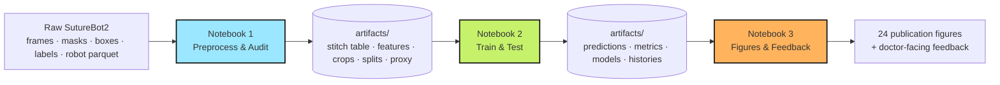
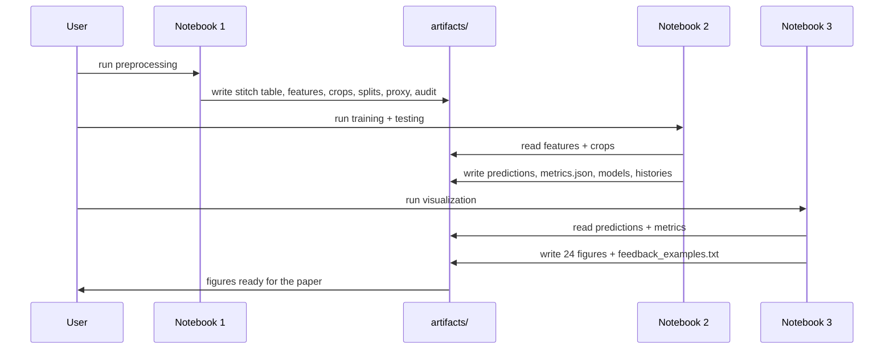
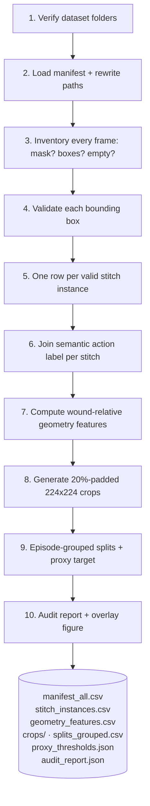
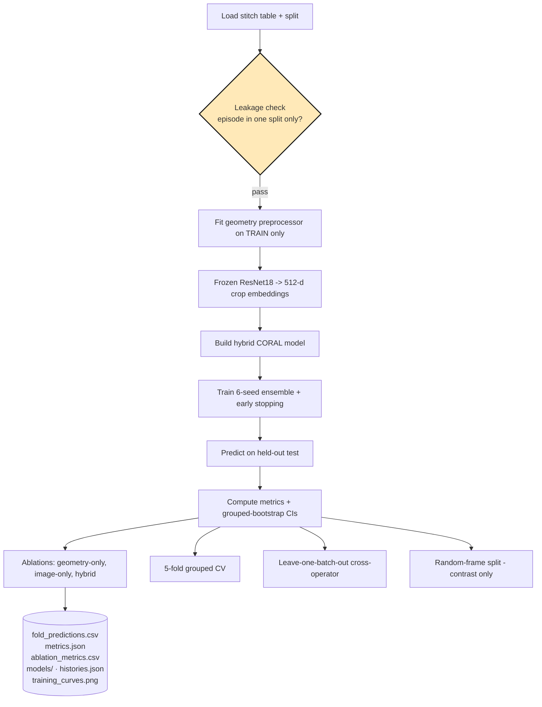
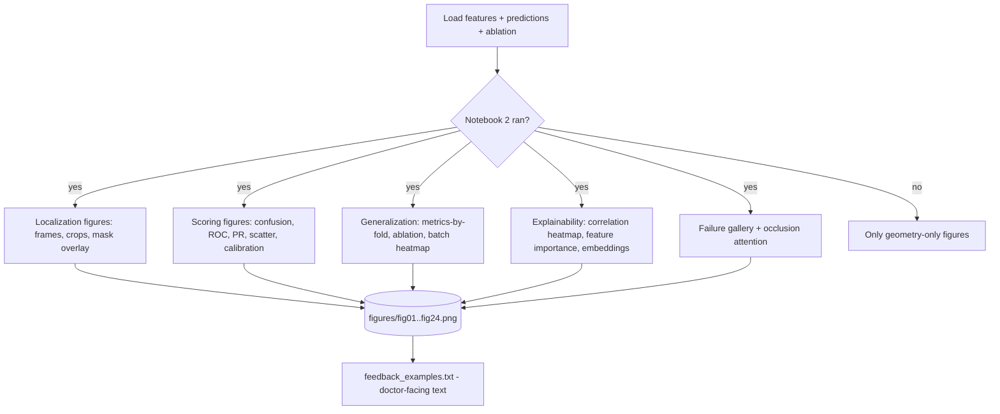
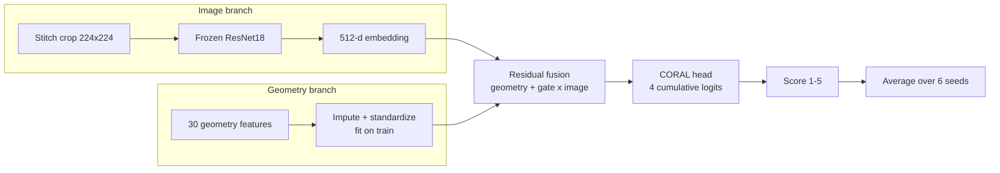
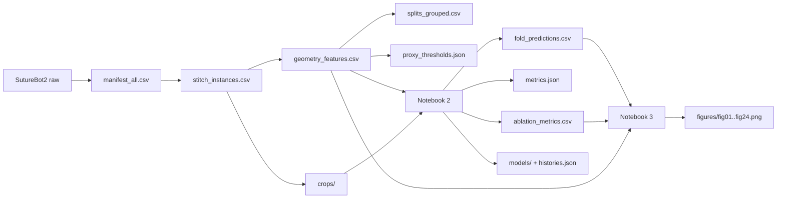
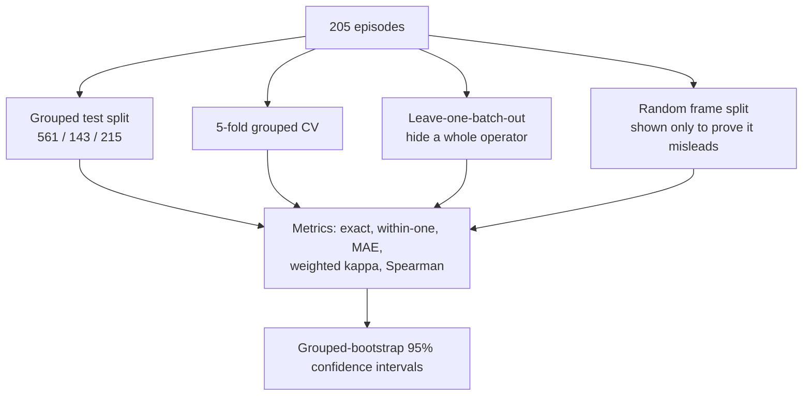

# Project Flow — Explainable Ordinal Stitch-Quality Assessment (SutureBot2)

This document describes **how the project flows from raw data to a finished result**. Think of it as the map: what comes in, what happens, what comes out, and how each part connects to the next.

> Legend: **Notebook 1** = `01_preprocess_and_audit.ipynb` · **Notebook 2** = `02_train_and_test_models.ipynb` · **Notebook 3** = `03_visualize_results_and_feedback.ipynb` · `sutureqc/` = the shared Python package that does the real work.

---

## 1. The big picture (one glance)



**In words:**
- **Notebook 1** turns the messy download into a clean, leak-free **stitch table** (one row per stitch) plus features, crops, splits and a target.
- **Notebook 2** trains and tests the models on that table and writes predictions + metrics.
- **Notebook 3** turns those results into the figures and the clinician-facing explanation.

---

## 2. End-to-end sequence



---

## 3. Stage 1 — Notebook 1: Preprocess & Audit

Purpose: **turn raw data into one clean row per stitch**, with everything the models need.



**Key rules inside this stage**
- Split by **episode**, never by frame (frames from one episode are near-duplicates).
- Fit the geometry scaler **and** the proxy thresholds on **training rows only**.
- Keep empty-box frames as detection negatives but never score them.

**Output that the rest of the project depends on:** `geometry_features.csv` (stitches + features + proxy score + split) and `crops/`.

---

## 4. Stage 2 — Notebook 2: Train & Test

Purpose: **train the models, test them honestly, and measure accuracy.**



**Key rules inside this stage**
- The scaler and any thresholds are fit on **train only** (no leakage).
- The ResNet18 is **frozen** — no fitting, so the embeddings cannot leak.
- The headline model is the **geometry-dominant residual hybrid**, averaged over 6 seeds.
- The honest generalization number is **leave-one-batch-out**, not the easy split.

---

## 5. Stage 3 — Notebook 3: Figures & Feedback

Purpose: **turn results into paper figures and a doctor-facing explanation.**



---

## 6. Model flow (how one stitch becomes a score)



**Why this shape:** the geometry is the backbone; the image adds a **small, bounded correction** (so the model can never fall far below geometry-only). The CORAL head keeps the 1–5 score **ordered**.

---

## 7. Data → artifact flow (what feeds what)



---

## 8. Evaluation flow (how accuracy is measured)



**Reading the results**
- **Exact** = score matches; **within-one** = off by at most 1; **MAE** = average miss size.
- The **cross-operator** number (leave-one-batch-out) is the honest generalization figure.

---

## 9. How to run the flow (command line)

```text
1. Install:        python -m pip install -r requirements.txt
2. Notebook 1:     python -m nbconvert --to notebook --execute notebooks\01_preprocess_and_audit.ipynb --inplace
3. Notebook 2:     python -m nbconvert --to notebook --execute notebooks\02_train_and_test_models.ipynb --inplace
4. Notebook 3:     python -m nbconvert --to notebook --execute notebooks\03_visualize_results_and_feedback.ipynb --inplace
5. Overview page:  open index.html in a browser
```

Order matters: **Notebook 1 → Notebook 2 → Notebook 3** (each reads what the previous one wrote).

---

## 10. One-line summary

Raw SutureBot2 data → **Notebook 1** makes a clean, leak-free stitch table → **Notebook 2** trains and tests the hybrid ordinal model → **Notebook 3** produces the figures and the doctor-facing feedback, and everything is summarised on the `index.html` overview page.
